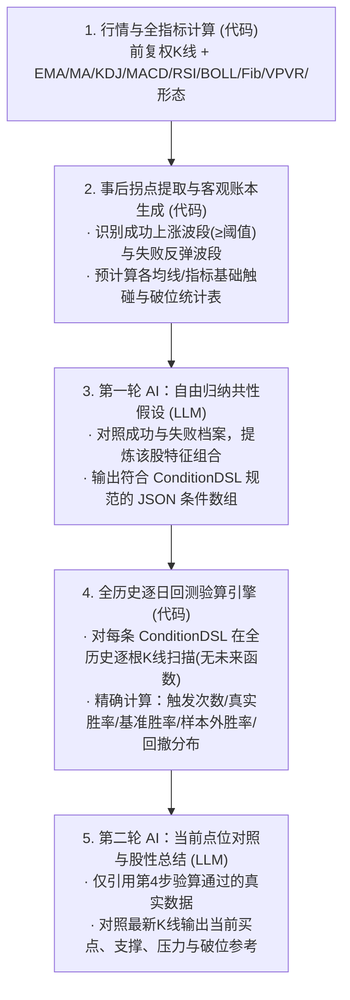

# 天台马后炮（Rooftop Hindsight）开发文档

版本：0.1.0
日期：2026-10-25
定位：天台宇宙（Rooftop Series）之**历史拐点共性挖掘与点位回测工具**。

---

## 一、产品设计（Product Design）

### 1.1 产品定位与职责边界

一句话：**用“事后诸葛亮”翻一只股票过去 1～5 年的历史旧账，找出它每次见底反弹、支撑企稳、受阻回落时的技术指标与形态共性，再用代码逐日回测验算这些共性的真实概率，最后对照当前最新 K 线给出高胜率参考买点与支撑压力位。**

为保证与「天台分析 (`zenith-quant`)」和「持仓纪律 (`trade-discipline`)」既能独立运行、将来又能无缝合并，严格划定边界：

| 维度 | 天台分析 (`zenith-quant`) | 天台马后炮 (`rooftop-hindsight`) | 持仓纪律 (`trade-discipline`) |
| :--- | :--- | :--- | :--- |
| **核心视角** | **当下截面**：对当前这一根 K 线的几十项指标做多空打分 | **历史纵向（事后诸葛亮）**：回溯过去 1～5 年所有波段高低点，挖掘该股独有的股性共性与真实胜率 | **买入之后**：管仓位、管每日收盘硬线与软线、管出场执行 |
| **核心产出** | 当前多空评分（0～5分）、阶段判定、技术研报 | 该股历史高胜率买点规律榜、支撑/假跌破/真破位统计、见顶风险规律、当前点位对照 | 建仓股数、每日明日硬线价格、软线状态、明天动作、交易日志 |
| **不负责的事** | 不挖掘该股历史个性化规律、不管持仓 | **不计算仓位、不设 R 值、不执行持仓跟踪止损止盈** | 不选股、不分析买点胜率 |

---

### 1.2 用户输入参数

界面顶部为极简参数栏，所有参数支持修改并实时重算：

| 参数名 | 字段名 | 默认值 | 可选范围 / 说明 |
| :--- | :--- | :--- | :--- |
| **股票代码** | `symbol` | — | 支持 A 股（`600519.SS`）、港股（`0700.HK`）、美股（`NVDA`）、日股（`7203.T` 或日经 ETF） |
| **回测周期** | `lookbackYears` | `2`（2年） | `1` / `2` / `3` / `5` 年（日线默认 2 年约 500 根 K 线；切换周线时建议选 3～5 年） |
| **K 线周期** | `timeframe` | `daily`（日线） | `daily`（日线） / `weekly`（周线） |
| **波段涨幅阈值** | `minSwingPct` | `10%` | 用户可改（如 `5%`、`8%`、`10%`、`15%`、`20%`）。代表从阶段性低点起算，累计上涨达到多少才算一次“值得研究的上涨波段”。附带快捷换算提示：*可按您预期的“止损比例 × 目标倍率”填入（如预期 5% 止损、2:1 倍率则填 10%）* |
| **验证观察窗口** | `horizonBars` | `40`（交易日） | `10` / `20` / `40` / `60` 交易日。当某条共性特征在历史上某天出现时，观察随后多少个交易日内能否走出 `minSwingPct` 涨幅 |
| **触碰容差** | `touchTolerancePct` | 自动（`0.5 × ATR%`） | 可手动指定（如 `1.5%`、`2%`、`3%`）。判断价格是否在某均线或支撑位“附近”的上下浮动带 |

---

### 1.3 三大核心功能模块

#### 模块 A：历史上涨波段起点共性挖掘（找买点）

1. **第一步：事后诸葛亮挑波段（生成成功/失败对照档案）**
   - **成功上涨波段档案**：在回测期内，基于真实最低点（事后视角），找出所有从阶段波谷低点起、在 `horizonBars` 内最大涨幅 ≥ `minSwingPct`（如 10%）的波段。记录每个波谷低点当天及前 3 天的全套指标与形态快照。
   - **失败反弹对照档案**：找出从局部低点有所反弹（如反弹 3%～6%）、但未能达到 `minSwingPct` 就掉头向下再创新低的案例。与成功档案并列，供 AI 对比“真底和下跌中继到底差在哪”。
2. **第二步：AI 自由归纳共性特征假设**
   - 不由人工预先写死规则，把成功与失败档案交给大模型，让其提炼出该股票高频出现的底部特征组合（例如：`价格在 EMA60 上下 2.5% 内 + KDJ 的 J < 5`、`回踩 EMA20 + 出现长下影线/锤头线`、`回调至斐波那契 0.618 + MACD 底背离`）。
3. **第三步：代码全历史逐日回测验算真实概率**
   - 把归纳出的每条特征组合，放到回测期内的**每一根 K 线**上逐日扫描（只要当天收盘满足特征，即视为一次触发，消除事后只看最低点的幸存者偏差）：
     - **历史触发总次数**（分母） vs **成功涨超 `minSwingPct` 的次数**（分子） → **真实胜率**；
     - **同期基准胜率**：回测期内任意交易日随机买入，在同样窗口内涨超 `minSwingPct` 的概率（衡量该规律比瞎买高出多少个百分点）；
     - **达标前最大回撤分布**：在成功涨超 `minSwingPct` 的那些案例中，入场后到涨达标之前，盘中经历的最大浮亏（中位数、80分位、最深一次）；
     - **失败案例结局**：未达标的那些次触发，后续平均最大跌幅是多少。

#### 模块 B：关键支撑与破位规律回测（找支撑与走坏信号）

针对该股票在回测期内的均线（EMA/MA 5、10、20、30、60、120、250）、斐波那契回撤位、前低水平支撑、筹码密集峰（VPVR POC）以及指标叠加组合，统计历史每次回踩/触碰后的真实走势：

1. **三类结局统计**：
   - **直接守住**：触碰容差带（如均线上下 3%）后止跌反弹，收盘未有效跌破；
   - **假跌破收回**：收盘跌破该位置，但在 1～2 个交易日内重新站回并继续上涨；
   - **真破位走坏**：连续 $\ge 2$ 个交易日收盘在该位置下方，随后继续下跌创出阶段新低。
2. **典型股性结论输出**：
   - 支撑有效率排行（如：*“过去 2 年回踩 EMA60 共 9 次，8 次止跌反弹（有效率 88.9%），企稳区间均在 EMA60 ±2.2% 内”*）；
   - 破位天数临界点（如：*“单日收盘跌破 EMA5 但次日收回的案例中，81% 继续上涨；但一旦连续 2 个交易日收在 EMA5 下方，有 84% 的概率一路向下创出区段新低”*）。

#### 模块 C：阶段见顶与强压力规律回测（找压力与卖点特征）

用与模块 A 对称的“事后诸葛亮”方式，提取回测期内所有阶段性高点（随后跌幅 ≥ `minSwingPct` 的波峰）：

- 归纳该股见顶回落的高频共性特征（例如：*“冲不破 EMA5 且伴随 MACD/RSI 顶背离”、“乖离率高于 EMA20 超过 12% 且出现长上影线”、“触及筹码上沿 VPVR VAH + KDJ 高位死叉”*）；
- 全历史逐日回测验算该见顶特征出现后的**真实下跌概率、平均跌幅与见顶前置天数**。

---

### 1.4 页面布局与交互设计

单页工作台设计（桌面端左右分栏，移动端上下流式布局）：

1. **顶部参数控制栏**：股票搜索框、回测周期（1/2/3/5年）、日/周线切换、波段涨幅阈值（10%）、观察窗口（40天）、分析模式切换（LLM 深度归纳 / 纯统计极速模式）、【开始回测】按钮。
2. **主视区左/上：交互式历史标记 K 线图（基于 Lightweight Charts）**
   - 叠加显示回测识别出的所有**历史阶段低点（波谷标记）**与**历史阶段高点（波峰标记）**；
   - 点击右侧规律榜中的任意一条规律，K 线图上自动高亮标出该规律在过去 2 年里的**每一次触发位置**（绿色标记=成功走出目标涨幅，灰色/红色标记=失败），让人肉眼直观核对“到底准不准”。
3. **主视区右/下：三合一分析面板**
   - **面板 1【当前行情对照卡片】**：
     - 当前最新收盘价是否正在触发（或距离多少百分比即将触发）某条高胜率规律；
     - 当前最近的**高胜率参考支撑位**（价格、距今百分比、历史守住率）与**高胜率参考压力位**（价格、距今百分比、历史受阻率）；
     - 【复制点位摘要 / 发送至持仓纪律】快捷按钮。
   - **面板 2【历史高胜率规律榜（买点 / 支撑 / 破位 / 见顶）】**：
     - 每条规律展示：条件组合描述、历史触发次数、成功次数、**真实胜率（对比随机基准胜率）**、样本外（近30%时间）表现、达标前最大回撤分布、AI 股性解读。
   - **面板 3【历史波段档案明细表】**：
     - 展开可查看过去 1～5 年每一次阶段大底和大顶的具体日期、波段起止价格、最大涨幅、以及当时的指标快照原值（完全透明可查）。

---

## 二、技术选型与架构设计（Tech Stack & Architecture）

### 2.1 技术选型

与 `zenith-quant` 和 `trade-discipline` 保持 **100% 技术同构**，确保零摩擦合并：

| 层级 | 选型 | 理由 |
| :--- | :--- | :--- |
| **框架** | Next.js 16 (App Router) + React 19 | 与 `zenith-quant` 完全一致，支持服务端 API 路由与静态/动态渲染 |
| **语言** | TypeScript 5 (Strict Mode) | 保证指标快照、DSL 条件算子与跨项目数据接口的类型安全 |
| **样式与图标** | Tailwind CSS v4 + `lucide-react` | 与 `zenith-quant` 一致 |
| **K 线图表** | `lightweight-charts` ^5.2.0 | 复用 `zenith-quant` 图表封装，支持自定义 Markers（标记波谷/波峰/触发点）与价格线 |
| **行情数据源** | 复用 `zenith-quant` 行情模块 | 东方财富、同花顺、腾讯、Yahoo Finance、Kabutan，自带熔断器与多源降级 |
| **AI 接入** | OpenAI 兼容接口 / Gemini / Claude | 复用 `zenith-quant` 的 `llmProxy` 与 JSON 结构化解析器 |
| **测试框架** | Vitest ^4.1.8 | 毫秒级单元测试，与 `zenith-quant` 相同 |

---

### 2.2 核心计算管线与结构化条件 DSL

为了解决“纯写死规则太死板”与“纯 LLM 算数必产生幻觉”的矛盾，系统采用**「代码生成客观账本 → AI 组合 DSL 条件 → 代码执行全历史回测 → AI 撰写结论」**的四阶段管线：



#### 结构化条件表达式（Condition DSL）设计

AI 第一轮不输出无法验证的散文，而是从特征原子库中自由组合 `ConditionNode`（每条假设最多组合 3 个原子条件）：

```typescript
export type IndicatorAtomType =
  | "price_near_ma"          // 价格在某均线(EMA/MA 5~250)上下 [minPct, maxPct] 范围内
  | "ma_hold_or_reclaim"     // 跌破某均线后在 N 天内收回（未连续 M 天收在下方）
  | "ma_consecutive_break"   // 连续 N 天收盘在某均线下方（破位信号）
  | "ma_slope_direction"     // 某均线斜率向上/向下
  | "kdj_zone_or_cross"      // KDJ 的 J/K/D 处于极值区（如 J < 0, J > 100）或金叉/死叉
  | "rsi_zone"               // RSI 处于超卖/超买区间
  | "macd_state"             // MACD 金叉/死叉/底背离/顶背离/零轴上方缩脚
  | "candlestick_pattern"    // K线形态：长下影线(hammer/long_lower_shadow)、长上影、吞没、晨星等
  | "fib_retracement_near"   // 处于近期波段斐波那契 0.382 / 0.5 / 0.618 / 0.786 附近
  | "vpvr_zone_near"         // 处于筹码密集峰 POC / VAL / VAH 附近
  | "volume_ratio";          // 量比处于缩量（如 < 0.7）或放量（如 > 1.5）

export interface ConditionAtom {
  type: IndicatorAtomType;
  params: Record<string, number | string | boolean>;
}

export interface HindsightHypothesis {
  id: string;
  category: "bullish_entry" | "support_hold" | "breakdown_risk" | "bearish_peak";
  title: string;                // 人类可读简述，如 "回踩 EMA60 ±2.5% 且 KDJ J<10"
  conditions: ConditionAtom[];  // 1~3 个条件，逻辑与(AND)关系
  aiRationale: string;          // AI 为什么从历史档案中挑出这条共性
}
```

**为什么这样设计？**
1. **既有 AI 的灵性**：AI 看到这只股票的 12 个底部档案后，可以自由决定把 `EMA60` 和 `长下影线` 组合，或者把 `斐波那契 0.618` 和 `KDJ J<0` 组合，不受人工预设套路的限制。
2. **又有代码的 100% 准确度**：一旦 AI 输出了 `conditions` JSON，代码里的 `evaluateHypothesisOnHistory(candles, features, hypothesis)` 函数就能在 5 毫秒内扫完过去 1250 根 K 线，算出**一字不差的真实触发次数、真实胜率和每次触发的具体日期**。
3. **无 Key 兜底模式**：当用户未配置大模型 Key 时，本地引擎可自动对常见单因子及双因子高频组合进行网格扫描并按胜率排序输出，保证无 AI Key 时工具依然能独立跑通使用。

---

### 2.3 防过拟合与客观性硬约束

| 约束项 | 规则定死 | 说明 |
| :--- | :--- | :--- |
| **样本内 / 样本外切分** | 前 70% / 后 30% | 前 70% K 线用于提取高低点档案供 AI 归纳，代码回测时分别算出「样本内胜率」「样本外胜率」「全周期胜率」。若样本外胜率低于基准胜率，自动打上 `近期失效/股性变化` 警告标签 |
| **最少触发次数** | `minTriggers = 8` | 全周期触发次数 `< 8` 次的规律（周线或 1 年短周期放宽至 `< 5` 次），强制归类为 `样本不足（仅观察）`，不得排入高置信榜首 |
| **超额胜率门槛** | `winRate >= baseline + 10%` | 真实胜率必须比“同期任意一天随机买入”的基准胜率高出至少 10 个百分点，防止把大牛市普涨误认为指标神奇 |
| **零未来函数** | 严格隔离两阶段 | 第一步挑历史波谷/波峰允许用事后高低点；但第四步逐日扫描验算胜率时，第 `i` 天的 `features[i]` **绝对只能使用 `0..i` 已收盘 K 线计算**（例如第 `i` 天判断斐波那契位，只能用 `i` 之前已确认的前高前低，不能用 `i` 之后的未来高点） |

---

## 三、与「天台分析」「持仓纪律」合并的数据与技术设计要求

为了保证三个项目现在独立开发、将来合并到一个工程时**零重构、零字段冲突**，制定以下硬性设计规范：

### 3.1 目录结构隔离规范

本项目及未来三合一后的项目，在 `src/lib/` 下采用严格的子目录模块隔离：

```text
src/
├── lib/
│   ├── market/             # [共用底座] 从 zenith-quant 原样复用的多市场行情抓取、熔断、复权校验
│   ├── indicators/         # [共用底座] 基础技术指标纯函数（EMA, MA, ATR, KDJ, MACD, RSI, BOLL, Fib, VPVR, 形态）
│   ├── shared-types/       # [共用契约] 跨三个工具传递的标准 TypeScript 接口定义
│   ├── analysis/           # [天台分析专属] 截面多空评分、Jev 管线、截面研报
│   ├── hindsight/          # [天台马后炮专属] 历史波段提取、特征快照、ConditionDSL 执行器、胜率回测、两轮 AI 归纳
│   └── rules/              # [持仓纪律专属] 四阶段硬线/软线计算、开仓加仓计算器、R 值归档统计
```

**铁律**：`hindsight/` 内部只依赖 `market/`、`indicators/` 和 `shared-types/`，绝不反向耦合 UI 组件或特定数据库实现。

---

### 3.2 跨工具共享数据契约（`src/lib/shared-types/interop.ts`）

合并前通过 URL Query / JSON 剪贴板传递，合并后直接在内存或同库表中调用，统一使用以下数据结构：

```typescript
export type MarketCode = "CN" | "HK" | "US" | "JP";
export type TimeframeCode = "daily" | "weekly";

/**
 * 1. 天台马后炮 -> 天台分析 & 持仓纪律 的核心输出契约
 */
export interface HindsightKeyLevel {
  kind: "entry" | "support" | "resistance" | "breakdown";
  price: number;                    // 折算到当前 K 线的具体触发价格
  distancePct: number;              // 距离当前最新收盘价的百分比，如 -3.2 表示下方 3.2%
  sourceRuleTitle: string;          // 依据的历史规律，如 "EMA60 ±2% 支撑 (2年9次守住8次)"
  indicatorRef?: {                  // 结构化指标引用（供纪律工具或图表直接识别）
    type: "EMA" | "MA" | "HORIZONTAL" | "FIB" | "VPVR" | "COMPOSITE";
    period?: number;                // 如 EMA60 则为 60
    recommendedConfirmDays?: 1 | 2; // 历史假跌破统计得出的建议确认天数
    historicalTouchCount: number;
    historicalHoldRate: number;     // 0~1，如 0.889
    maxPierceDepthPct80: number;    // 守住案例中盘中刺穿深度的 80 分位（%），如 2.1
  };
}

export interface HindsightSummaryPayload {
  version: "hindsight-v1";
  symbol: string;
  market: MarketCode;
  name?: string;
  analyzedAt: string;               // ISO 时间戳
  lookbackYears: number;
  timeframe: TimeframeCode;
  minSwingPct: number;
  currentPrice: number;
  activeSignals: {                  // 当前已触发或临近触发的高胜率规律
    title: string;
    category: "bullish_entry" | "support_hold" | "breakdown_risk" | "bearish_peak";
    winRate: number;
    baselineWinRate: number;
    triggerCount: number;
    medianDrawdownBeforeTargetPct: number;
    maxDrawdownBeforeTargetPct90: number;
  }[];
  keyLevels: HindsightKeyLevel[];   // 当前参考买点、支撑位、压力位、破位位
}

/**
 * 2. 跨工具 URL 轻量联动参数协议（合并前独立部署期使用）
 * 示例：/calculator?symbol=7203.T&entry=2600&refSupport=2450&maType=EMA&maPeriod=60&confirm=2
 */
export interface CrossToolUrlParams {
  symbol: string;
  entry?: number;
  refSupport?: number;              // 参考支撑位/止损参考价
  refTarget?: number;               // 参考压力位/止盈目标价
  maType?: "EMA" | "MA";
  maPeriod?: number;
  confirm?: 1 | 2;
}
```

---

### 3.3 与「天台分析 (`zenith-quant`)」合并时的衔接设计

1. **行情与本地缓存零重复请求**：
   - `zenith-quant` 分析通常拉取 250～365 天日线；`rooftop-hindsight` 支持拉取 1～5 年（250～1250 根日线）。
   - 行情层扩展 `fetchHistoricalCandles(symbol, { years: 1 | 2 | 3 | 5, timeframe, adjust: "qfq" })`，内部按 `(symbol, timeframe, adjust)` 统一缓存，拉过 2 年数据后，天台分析的截面计算直接切片取末尾 250 根即可，无需二次请求上游接口。
2. **证据快照互喂**：
   - 合并后，天台马后炮跑出的 `activeSignals`（例如“当前正处于过去 2 年 85% 胜率的 EMA60+J<0 共振区”）可直接作为一条高权重历史统计证据注入天台分析的 `EvidenceSnapshot`；
   - 反过来，天台分析已经算好的 18 种经典形态、24 种 K 线组合、MACD/RSI 背离函数，直接作为 `rooftop-hindsight` 的特征原子计算器，两套系统共用同一套指标实现。

---

### 3.4 与「持仓纪律 (`trade-discipline`)」合并时的数据库与路由设计

1. **数据库表命名空间隔离（Turso / Drizzle ORM）**：
   - `trade-discipline` 使用的表：`accounts`, `positions`, `lots`, `snapshots`, `trades`；
   - `rooftop-hindsight` 若开启云端持久化，表名统一加 `hindsight_` 前缀：`hindsight_reports`（回测报告缓存）、`hindsight_validations`（前向验证记录）。
   - 未来合库时，两套表在同一个 `schema.ts` 下互不冲突，且 `positions` 表只通过可选字段 `source_hindsight_id` 弱关联回测报告，随时可独立手填。
2. **前端路由规划**：
   - 独立运行时：首页 `/` 即为天台马后炮工作台；
   - 未来三合一时：
     - `/analyze`：天台分析（当下多空截面诊断）
     - `/hindsight`：天台马后炮（历史拐点与点位胜率回测）
     - `/discipline`：天台纪律（持仓看板、开仓加仓计算器、交易日志）

---

## 四、测试计划与测试用例（Test Plan & Test Cases）

遵守编码准则：**所有核心计算模块必须配备确定性的 Vitest 单元测试，不依赖外部网络或真实大模型即可跑通全部核心逻辑验证。**

### 4.1 测试分层策略

| 测试层级 | 工具 | 覆盖范围 | 执行时机 |
| :--- | :--- | :--- | :--- |
| **L1 单元与纯算法测试** | Vitest | 阶段高低点识别、逐日特征快照（无未来函数校验）、ConditionDSL 执行器、假跌破/真破位统计、样本内外切分 | 每次代码修改必跑（`npm run test:run`） |
| **L2 AI 契约与容错测试** | Vitest (Mock LLM) | 验证 AI 返回畸形 JSON、越界条件名、自造不存在的指标时的服务端拦截与降级逻辑 | 每次代码修改必跑 |
| **L3 合成行情端到端基准测试** | Vitest | 构造确定性的合成 K 线序列（例如：精准构造 10 次回踩 EMA20，其中 8 次涨 12%、2 次跌破），断言回测引擎算出的触发次数=10、胜率=80.0%，误差为 0 | M1 里程碑验收核心标准 |
| **L4 页面与接口冒烟测试** | Next Build + API 调用 | 验证 `/api/hindsight` 接口在真实/模拟股票代码下的完整返回与前端图表渲染 | M3/M4 里程碑验收 |

---

### 4.2 核心测试用例清单（Test Cases）

#### 测试套件 1：历史波段高低点提取（`swingExtractor.test.ts`）

| 用例编号 | 测试场景 | 输入数据 | 预期输出 / 断言 |
| :--- | :--- | :--- | :--- |
| **TC-SW-01** | 标准有效上涨波段识别 | 构造 200 根 K 线，其中第 30 根低点为 `100.0`，第 55 根最高涨至 `115.0`（+15%），参数 `minSwingPct = 10%`, `horizonBars = 40` | 准确识别出第 30 根为有效成功波谷，记录涨幅 `15.0%`，达标用时 `25` 根 K 线 |
| **TC-SW-02** | 未达阈值的微弱反弹过滤 | 低点 `100.0` 反弹至 `106.0`（+6%）后跌破 `95.0`，参数 `minSwingPct = 10%` | 该点**不进入**成功波段档案，而是被正确归入「失败反弹对照档案」 |
| **TC-SW-03** | 同一波段内多次小回撤去重 | 低点 `100.0` → `104` → `101` → `113`（主升浪中途未跌破起点） | 只记录 `100.0` 这 1 个波段起点，不把中途的 `101` 重复记为第二个独立波段起点（防止样本重复膨胀） |
| **TC-SW-04** | 阶段见顶波峰识别 | 高点 `150.0` 在 30 天内跌至 `132.0`（-12%），阈值 `10%` | 准确识别为阶段见顶波峰，记录最大跌幅 `-12.0%` |

#### 测试套件 2：逐日特征计算与“零未来函数”校验（`featureTimeline.test.ts`）

| 用例编号 | 测试场景 | 输入数据 | 预期输出 / 断言 |
| :--- | :--- | :--- | :--- |
| **TC-FT-01** | 严禁未来函数（截断一致性测试） | 给一段 300 根 K 线，先传入全部 300 根算第 150 根的特征快照 `F_full[150]`；再只传入前 150 根算最后一根的特征快照 `F_sliced[150]` | `F_full[150]` 与 `F_sliced[150]` 的所有字段（均线距离、连续破位天数、KDJ、背离、斐波那契位置、VPVR）**必须 100% 严格相等** |
| **TC-FT-02** | 连续跌破均线天数计数 | 收盘价相对于 EMA5 序列为：`[上, 下, 下, 上, 下, 下, 下]` | 对应天数的 `consecutiveBarsBelow.EMA5` 序列严格等于 `[0, 1, 2, 0, 1, 2, 3]` |
| **TC-FT-03** | 长下影线与锤头线识别 | 开盘 `102`，最高 `103`，最低 `96`，收盘 `101.5`（下影线长度占全天振幅 > 65%） | 形态特征包含 `long_lower_shadow` 与 `hammer` |

#### 测试套件 3：ConditionDSL 回测与胜率验算引擎（`hypothesisEvaluator.test.ts`）

| 用例编号 | 测试场景 | 输入数据 | 预期输出 / 断言 |
| :--- | :--- | :--- | :--- |
| **TC-EV-01** | 合成行情精确胜率测试 | 构造 500 根合成 K 线，精确埋入 10 次触发 `close 在 EMA60 ±2% 且 J < 0`，其中 8 次在 40 天内涨超 10%，2 次继续下跌 | `triggerCount === 10`，`winCount === 8`，`winRate === 0.80` |
| **TC-EV-02** | 冷却期去重（防止同一波底部连续 3 天满足条件算作 3 次独立触发） | 某次底部连续 3 个交易日都满足 `EMA60 ±2% 且 J < 0`，随后涨了 15% | 在最小冷却间隔（如 5 个交易日内同一信号簇）下合并记为 **1 次独立波段触发**（同时保留逐日明细供查看），防止把 1 次底部涨 15% 虚增成“连赢 3 次” |
| **TC-EV-03** | 达标前最大回撤（MAE）计算 | 第 `t` 天以收盘价 `100` 触发信号，第 `t+3` 天盘中最低跌至 `95.5`，第 `t+18` 天涨至 `110`（达标 10%） | 该次成功样本的 `maxDrawdownBeforeTargetPct` 精确等于 `-4.5%` |
| **TC-EV-04** | 70/30 样本内外切分与失效降级 | 前 70% 区间触发 8 次赢 7 次（87.5%），后 30% 区间触发 4 次赢 0 次（0%） | 全周期汇总标记 `outOfSampleDegraded = true`，输出警告“近期样本外表现失效” |
| **TC-EV-05** | 样本不足门槛拦截 | 全周期仅触发 4 次，4 次全胜（100%） | 状态强制标为 `insufficient_sample`（仅观察），不进入高置信规律榜首 |

#### 测试套件 4：关键位守住 / 假跌破 / 真破位统计（`keyLevelStats.test.ts`）

| 用例编号 | 测试场景 | 输入数据 | 预期输出 / 断言 |
| :--- | :--- | :--- | :--- |
| **TC-KL-01** | 单日假跌破 vs 连续 2 天真破位 | 构造 12 次跌破 EMA5：其中 8 次第 1 天跌破、第 2 天收盘收回并续涨；4 次连续 2 天收在 EMA5 下方后跌幅超 8% | 1天内收回继续上涨率 = `8/8 = 100%`；连续2天跌破后创新低率 = `4/4 = 100%` |
| **TC-KL-02** | 守住案例的刺穿深度分位数 | 9 次回踩 EMA60 守住的案例中，盘中最低价低于 EMA60 的幅度分别为 `[0.2%, 0.5%, 0.8%, 1.0%, 1.2%, 1.5%, 1.8%, 2.1%, 3.0%]` | 正确算出中位数 `1.2%`、80 分位数 `2.1%` |

#### 测试套件 5：AI 输出校验与跨工具数据契约（`aiContractAndInterop.test.ts`）

| 用例编号 | 测试场景 | 输入数据 | 预期输出 / 断言 |
| :--- | :--- | :--- | :--- |
| **TC-AI-01** | 拦截 AI 编造不存在的特征算子 | Mock AI 第一轮返回 `{ type: "astrology_moon_phase", params: {} }` | 校验器自动过滤掉非法算子，仅保留合法的 `ConditionAtom`，不崩溃 |
| **TC-AI-02** | 拦截 AI 超出复杂度上限 | Mock AI 返回包含 6 个 AND 条件的假设 | 自动截断或拒绝超过 3 个条件的过拟合假设 |
| **TC-IO-01** | 跨工具 URL 参数序列化与反序列化 | 输入 `HindsightSummaryPayload` 生成跳转 `trade-discipline` 的 URL 参数再解析 | `symbol`, `entry`, `refSupport`, `maType`, `maPeriod`, `confirm` 往返转换无精度丢失 |

---

## 五、开发里程碑（Milestones）

每个里程碑均可独立运行和验证：

### M1：行情底座与纯算法回测内核（2～3 个工作日）
- 搭建 Next.js + TypeScript + Vitest 工程骨架；
- 迁入 `zenith-quant` 的多市场行情抓取与基础指标库，扩展支持 1～5 年历史日/周线拉取；
- 实现 `src/lib/hindsight/` 核心纯函数：
  - 阶段波谷/波峰提取器（`swingExtractor.ts`）
  - 无未来函数的逐日特征时间线（`featureTimeline.ts`）
  - 支撑/假跌破/真破位统计器（`keyLevelStats.ts`）
  - 结构化条件回测执行器（`hypothesisEvaluator.ts`）与本地高频组合扫描器（无 AI Key 兜底引擎）
- **M1 验收标准**：上述 `TC-SW`、`TC-FT`、`TC-EV`、`TC-KL` 全部单元测试 100% 通过；用命令行脚本跑一只真实股票（如日经 ETF 或贵州茅台 2 年日线）可直接打印出历史波段档案与高胜率规律表。

### M2：两轮 AI 归纳管线与服务端接口（1～2 个工作日）
- 实现第一轮 AI（读高低点档案 → 输出结构化 `HindsightHypothesis[]`）与第二轮 AI（读代码验算结果 → 解读当前位置与参考点位）；
- 实现 `/api/hindsight` 路由、输入哈希缓存、AI 输出校验与无 Key 自动降级本地网格归纳；
- **M2 验收标准**：`TC-AI` 与 `TC-IO` 测试全部通过，接口返回完整的 `HindsightSummaryPayload`。

### M3：前端交互工作台与 K 线历史标记图层（2 个工作日）
- 实现顶部参数栏（代码搜索、1/2/3/5年周期、日/周线、波段涨幅阈值可改）；
- 实现 Lightweight Charts K 线图叠加历史波谷/波峰标记，以及点击某条规律时在 K 线图上高亮每次历史触发点（胜/负分色）；
- 实现当前行情对照卡片、高胜率规律榜（买点/支撑/破位/见顶）、历史波段明细抽屉；
- 提供一键复制点位 / 生成 `trade-discipline` 联动链接。

### M4：前向验证记账与多语言/细节打磨（1 个工作日）
- 复用 `zenith-quant` 的浏览器验证记账机制：记录每次分析时触发的入场信号与支撑/压力点位，事后拉取新行情自动核对“后来到底涨没涨、支撑到底守没守住”。
